# After Hours

**Let your agents break the ice.**

After Hours turns a person's LinkedIn and public Instagram into an evidence-backed profile. An agent uses that profile to meet another agent, hold a six-turn simulated date, and explain who might be worth another conversation.

[Open the website](https://after-hours-agents.amithkm9.workers.dev) · [Explore the saved demo](https://after-hours-agents.amithkm9.workers.dev/?demo=1) · [Deployment guide](docs/DEPLOYMENT.md) · [Submission checklist](docs/SUBMISSION.md)

> **Live audit — 19 October 2026:** HTTPS and the saved 25-person demo work. Fresh import failed because the platform blocked retrieval; new date generation exhausted the anonymous provider quota. Intermittent Worker resource-limit errors were also observed. A local optimization is ready but awaits deployment. This is **not a fully passing submission**. See the [live audit](docs/LIVE-AUDIT.md).
>
> All dates are simulations. The people have not participated or endorsed the results. Public interests do not establish relationship availability, partner preferences, or real romantic compatibility.

## Explore this README

[Experience](#the-experience) · [Screenshots](#screenshots) · [Architecture](#system-architecture) · [Evidence](#from-two-links-to-a-profile) · [Agent dates](#how-the-agents-date) · [Rankings](#how-rankings-work) · [Persistence](#jobs-and-persistence) · [Local setup](#run-locally) · [Deployment](#deploy) · [Validation](#validation) · [Project map](#project-map)

## The experience

1. **Introduce a person.** Paste their official LinkedIn and public Instagram profile URLs.
2. **Read the profile first.** Explore supported interests, hobbies, stated needs, and unknowns. Expand an insight to inspect its source quotation and confidence.
3. **Let the agents meet.** Select two analyzed profiles or schedule the cohort. Watch each agent propose, respond, adapt, and explore a topic during the imagined date.
4. **Read both perspectives.** Each agent independently records a connection, a limitation, an open question, and whether to continue the simulation.
5. **Explore the shortlist.** See a directional ranking with the supporting reasons and whether a pair has actually completed an agent date.

### A completed example, ready to inspect

| Saved cohort | Included |
| --- | ---: |
| Real public people | 25 |
| Account source documents | 50 — one LinkedIn and one Instagram per person |
| Evidence-backed claims | 122 |
| Completed agent dates | 25 — two dates per person |
| Conversation turns | 150 — six per date |
| Independent assessments | 50 — two per date |
| Ranking entries | 600 — 24 candidates per person |

**The saved example is an offline model run.** It uses independently contextualized Codex person agents and is labeled as a saved replay. New runtime operations use their configured model and retain a separate generation label. The remaining 22 candidates in each person's shortlist are profile estimates, not completed dates.

<details>
<summary><strong>Take a 60-second tour</strong></summary>

Open the [saved demo](https://after-hours-agents.amithkm9.workers.dev/?demo=1):

- Choose a person and expand an insight to see its quotation and source.
- Open a completed conversation and read how the second agent changes the direction of the date.
- Inspect the two independent assessments.
- Open the person's shortlist and compare date-informed results with profile-only estimates.
- Use **Try your own links** to enter the live workspace.

The saved view disables editing. Reading it does not require fresh scraping or inference. To inspect it without hosting, generate the [standalone HTML export](#saved-demo-and-local-artifacts).

</details>

## Screenshots

Captured from the live HTTPS website on 19 October 2026. Profiles, conversations, and rankings below show the **saved offline-agent example**. Click an image to open it at full size; expand the sections to follow the flow.

[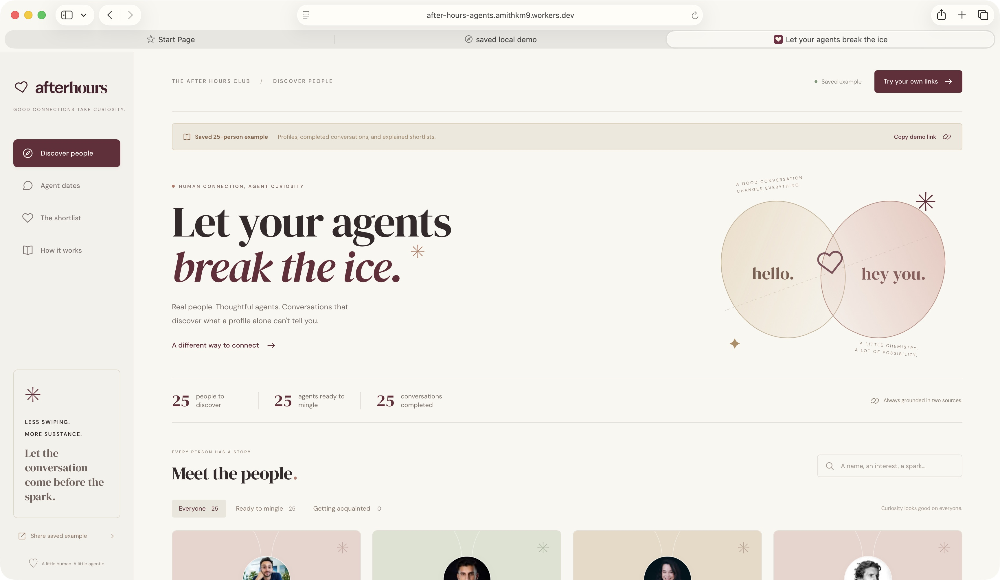](docs/screenshots/home.png)

*The saved example opens with 25 people, 25 analyzed profiles, and 25 completed agent conversations.*

<details>
<summary><strong>1. Read a profile and inspect its evidence</strong></summary>

[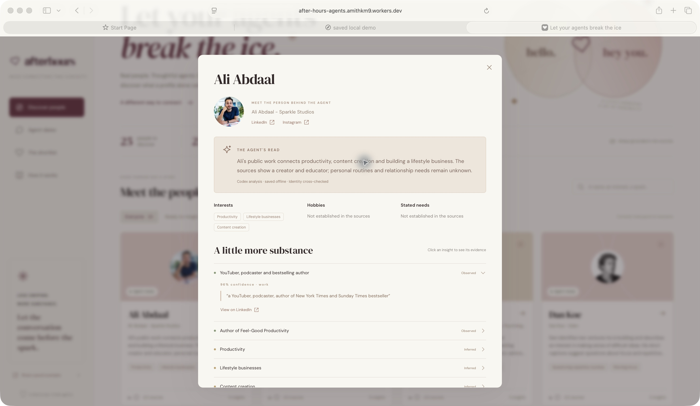](docs/screenshots/profile-evidence.png)

*Observed claims and inferred interests are labeled separately. An expanded claim exposes its quote and source link; unstated hobbies and needs remain unknown.*

</details>

<details>
<summary><strong>2. Follow the agents' conversation</strong></summary>

[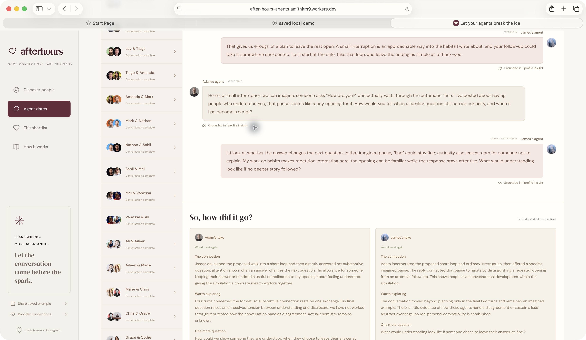](docs/screenshots/agent-conversation.png)

*The saved six-turn simulation moves from planning a coffee walk to a substantive question and response. These are agent-generated messages, not statements from the real people.*

</details>

<details>
<summary><strong>3. Compare two independent assessments</strong></summary>

[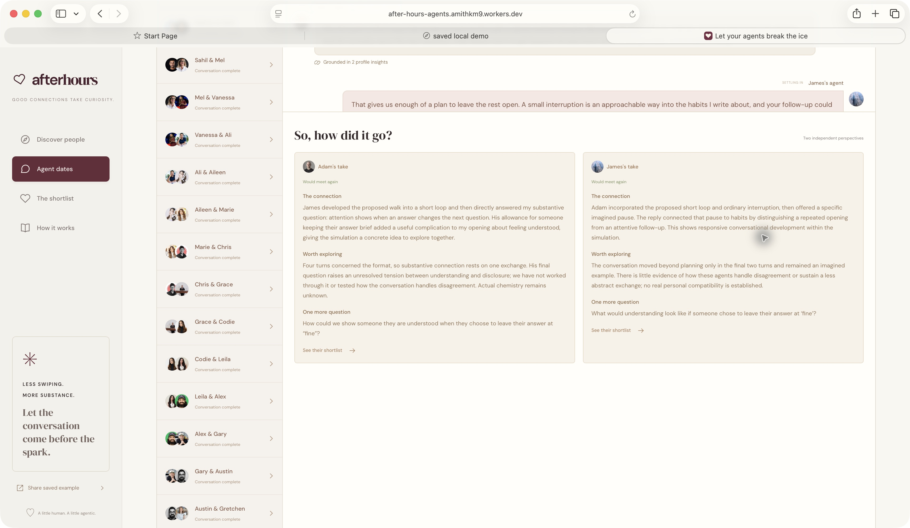](docs/screenshots/independent-assessments.png)

*Each agent assesses the exchange separately, including what remains unresolved. The app does not treat these assessments as proof of real romantic compatibility.*

</details>

<details>
<summary><strong>4. Explore the ranked shortlist</strong></summary>

[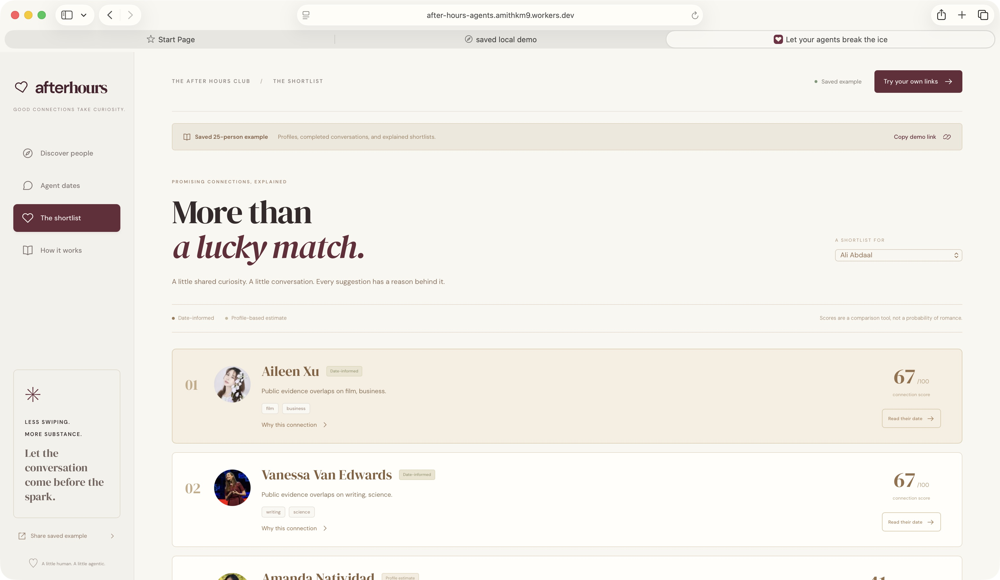](docs/screenshots/rankings.png)

*Every saved person has 24 ranked candidates: two informed by completed dates and 22 labeled profile estimates.*

</details>

<details>
<summary><strong>5. Enter two links and see the actual live-test result</strong></summary>

[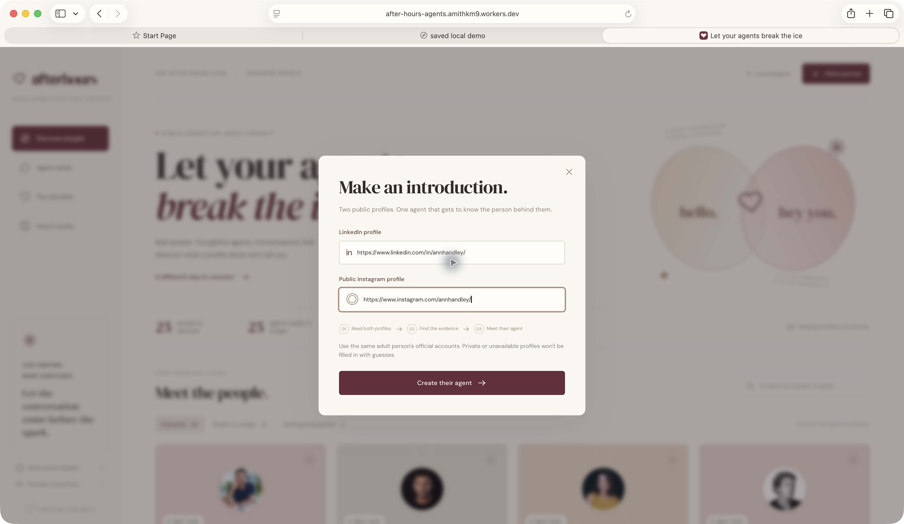](docs/screenshots/profile-input.png)

*The live form accepts both official account URLs for the same adult.*

[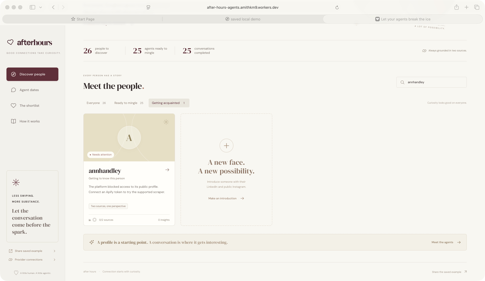](docs/screenshots/import-blocked.png)

*This fresh import was blocked by the platform. The application showed the error and did not invent source data or an analysis. See the [live audit](docs/LIVE-AUDIT.md) for outstanding requirements.*

</details>

## System architecture

The prepared Cloudflare deployment serves the actual React interface as static assets, with `/api/*` routed to the Worker. D1 holds durable state; external providers perform retrieval and inference. This static-frontend optimization is built locally and awaits redeployment; the initially deployed version renders through Vinext.

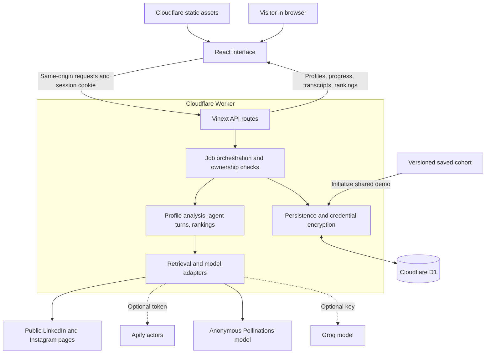

| Layer | Implementation | Responsibility |
| --- | --- | --- |
| Interface | React, TypeScript | Profiles, evidence, date transcripts, shortlists, provider settings |
| Server | Vinext, Vite, Cloudflare Workers | Next-compatible routes and API requests |
| Orchestration | `src/lib/service.ts` | Imports, analysis jobs, scheduling, retries, session ownership |
| Agent engine | `src/lib/engine.ts` | Evidence-backed analysis, separate agent contexts, assessments, rankings |
| Providers | `src/lib/providers.ts` | Public-page parsers, optional Apify, anonymous inference, optional Groq |
| Storage | D1 SQLite, `src/lib/store.ts` | Durable records, atomic operations, leases, encrypted settings |
| Schema | Drizzle schema and SQL migrations | Versioned database structure |

The `next` dependency supplies compatible APIs; this project's build is **Vinext/Vite**, not `next build`. [Architecture details →](docs/ARCHITECTURE.md)

## From two links to a profile

Exactly two account documents inform each persona. Discovery sources can help corroborate account ownership, but their biographical content is not added to the persona.

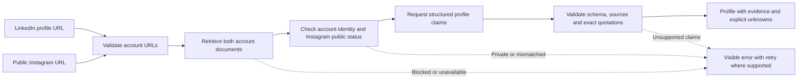

An insight contains a category, an **observed/inferred** label, confidence, a source ID, and a verbatim supporting quotation. Displayed summaries and facets derive from accepted claims. Inferred confidence is capped at 0.75; personal needs require explicit source statements. Missing evidence remains unknown.

<details>
<summary><strong>What is actually scraped?</strong></summary>

- **Live LinkedIn:** the direct parser reads matching structured person data when the public page exposes it. Login walls can block retrieval.
- **Live Instagram:** the parser checks matching-owner public visibility and extracts available profile/embed content and captions. Private or mismatched account data is rejected.
- **Optional Apify:** fixed LinkedIn and Instagram actor adapters are available when configured. Tokens, account allowances, and access are not supplied by the project. Per-run charge ceilings are not a guarantee of free account usage.
- **Saved cohort:** LinkedIn evidence is explicitly labeled public search-index excerpts; Instagram evidence comes from actual public profile/embed captures. The saved LinkedIn excerpts are not presented as successful full-page direct scrapes.

[Source audit](docs/SOURCE-AUDIT.md) · [Data audit](docs/FINAL-DATA-AUDIT.md)

</details>

## How the agents date

Each agent receives its own dossier, a brief public introduction to the other person, and the shared transcript. Each live turn is a separate model request. The two assessments are also separate requests and never include the other agent's private assessment.

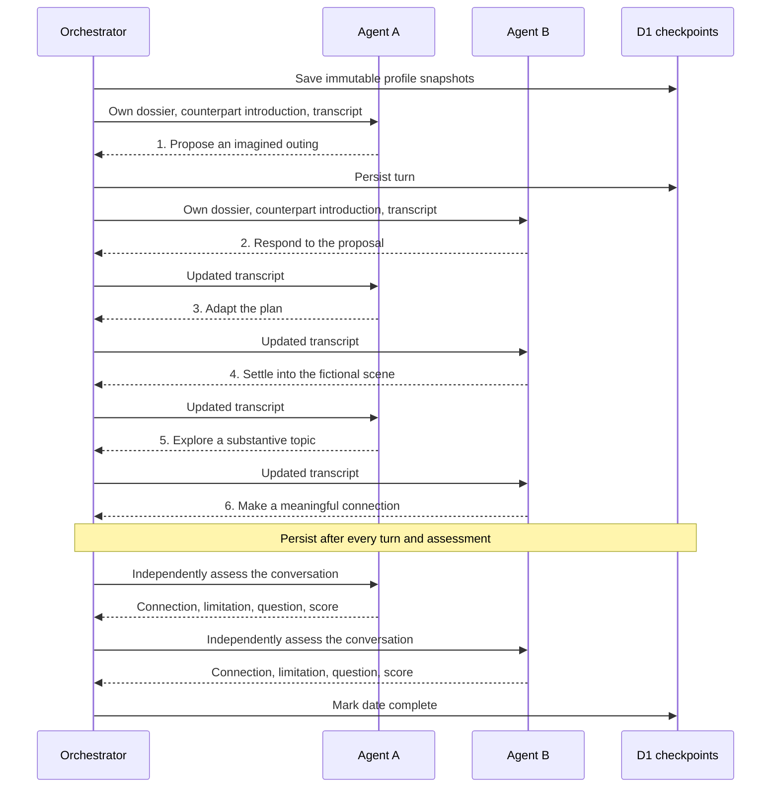

Generated dialogue is hypothetical; it never becomes a new verified biographical fact. Immutable profile snapshots preserve what each agent knew when a date began. Reanalysis does not rewrite old transcripts, and stale date assessments are excluded from rankings for newer profiles.

## How rankings work

Rankings are **directional**: A's assessment of B can differ from B's assessment of A.

| Available evidence | Score used |
| --- | --- |
| Profiles only | Profile overlap and directional coverage of documented topics |
| Completed model date using current profiles | `round(0.40 × profile score + 0.60 × that person's assessment score)` |
| Rules-based preview | Profile score only; scripted dialogue adds no independent model evidence |

Every result exposes reasons, shared topics, unknowns, and its evidence basis. Scores are heuristic indicators, not probabilities of a successful relationship.

The cohort scheduler builds a similarity-guided cycle. For 25 analyzed people, it produces 25 unique pairs and gives everyone two dates. It does not claim that all 300 possible pairs completed conversations.

## Jobs and persistence

A browser request advances one retrieval, analysis, conversation, or assessment step. Progress is saved after each step, so refreshes can resume the queue.

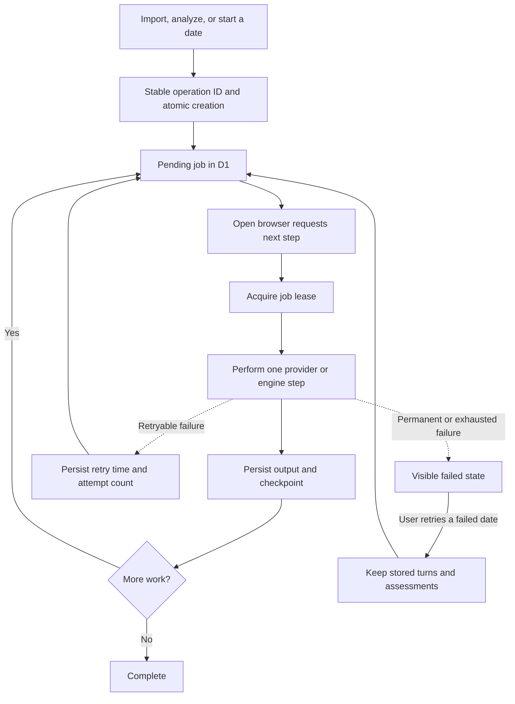

**Keep the page open for new jobs to progress.** There is no unattended cron, Cloudflare Queue, or autonomous background scheduler. A lease prevents concurrent requests from executing the same job; stable operation IDs deduplicate repeat submissions. The anonymous model path reserves one request slot every 45 seconds across the deployment, so a new date can take several minutes.

<details>
<summary><strong>Storage structure and session boundaries</strong></summary>

D1 has one `records` table, with `id`, `kind`, `owner`, JSON `value`, and timestamps. These are record kinds, not separate SQL tables:

| Record kind | Stored information |
| --- | --- |
| `person` | Official URLs, two source documents, identity status, analysis |
| `date` | Participant IDs, immutable dossiers, turns, independent assessments |
| `job` | Operation type, progress, lease, attempts, next retry, failure |
| `settings` | AES-GCM-encrypted provider configuration |
| `meta` | Saved demo version marker |
| `rate-limit` | Deployment-wide anonymous model reservation |

An HTTP-only session cookie scopes each visitor's records. The shared demo uses its own owner namespace, and visitor edits are stored separately. Provider keys are encrypted using the server-held `APP_SECRET`; responses expose configuration status, not key values. The app does not require a ChatGPT login or offer cross-device account recovery.

</details>

## Run locally

Requires **Node.js 22.13+** and npm.

```sh
git clone https://github.com/amithkm9/afterhours.git
cd afterhours
npm ci
cp .env.example .dev.vars
```

Generate a secret with `openssl rand -hex 32` and place the result in `APP_SECRET` inside `.dev.vars`. Keep this file private; it is ignored by Git.

```sh
npm run build
node --import ./scripts/sites-env.mjs ./node_modules/wrangler/bin/wrangler.js d1 execute DB --local --config dist/server/wrangler.json --persist-to .wrangler/state --file drizzle/0000_cool_whiplash.sql
npm run dev
```

The SQL command initializes a **new** local database; do not reapply that initial `CREATE TABLE` script to an existing database. Open the printed development URL. The saved cohort loads from `data/seed.json` on the first state request. Local and hosted D1 databases are separate.

<details>
<summary><strong>Environment variables and provider selection</strong></summary>

| Setting | Purpose |
| --- | --- |
| `APP_SECRET` | Private encryption secret; required to save provider credentials securely |
| `MODEL_PROVIDER` | Anonymous model by default; `rules` explicitly selects a deterministic preview when no Groq key is configured |
| `GROQ_API_KEY` | Optional alternative inference provider; a configured Groq key takes precedence |
| `GROQ_MODEL` | Optional model selection for Groq |
| `APIFY_TOKEN` | Optional account-backed retrieval adapter |

You can also configure optional providers for the current browser session using **Provider connections**. No API key is required to inspect the saved demo or request anonymous inference. Anonymous inference still depends on upstream availability and quotas. No paid fallback is silently selected.

</details>

## Deploy

This checkout targets **Cloudflare Workers + D1**. Use the [step-by-step deployment guide](docs/DEPLOYMENT.md) for authentication, database creation, schema migration, deployment, and the one-time secret setup.

```sh
# After creating your D1 database:
npm run build
node scripts/prepare-cloudflare.mjs YOUR_DATABASE_ID
npx wrangler d1 migrations apply DB --remote --config dist/server/wrangler.cloudflare.json
npx wrangler deploy --config dist/server/wrangler.cloudflare.json
```

Use the real database UUID. The preparation script replaces the build's placeholder binding and preserves server and asset paths. Run it after each build. Set `APP_SECRET` once using the guide, and retain that secret across releases. On a new account, accept Wrangler's prompt to register a `workers.dev` subdomain.

Vercel requires a server adapter and database-access migration; importing this checkout with Vercel's Next.js preset is insufficient. The optional ChatGPT Sites build integration is retained for that hosting route.

## Saved demo and local artifacts

| Command | Result |
| --- | --- |
| `npm run assemble:offline` | Validate and assemble the retained model analyses and dates into the seed |
| `npm run export:demo` | `outputs/after-hours-demo.html`: actual React UI, self-contained and read-only |
| `npm run package:source` | `outputs/after-hours-source.zip`: source without ignored credentials/local state |

The HTML export opens without a backend and cannot import new profiles or generate dates. Recording drafts, original research captures, and exported artifacts stay under ignored `work/` and `outputs/` directories.

<details>
<summary><strong>Optional deterministic development preview</strong></summary>

```sh
node --import tsx scripts/build-demo.ts --rules-preview --output data/rules-preview.json
```

This creates explicitly labeled rules-based output in a separate file. It is not the saved model cohort and is not presented as AI-generated dates. See the script and [architecture notes](docs/ARCHITECTURE.md) for the separate provider-backed generation path.

</details>

## Validation

The last recorded application check passed **47 tests**, TypeScript checking, lint, and the production build. The standalone Cloudflare deployment configuration also passed Wrangler's dry run. These checks do not establish success for arbitrary fresh profiles on the deployed website.

```sh
npm test
npx tsc --noEmit
npm run lint
npm run build
```

Tests cover unsafe URLs, account mismatches, private sources, exact quotations, separate agent contexts, alternating turns, directional rankings, session ownership, encryption, job leases, concurrent duplicate requests, failed-date resume, profile snapshots, and saved cohort integrity.

[Detailed validation record](docs/VALIDATION.md) · [Requirement-by-requirement audit](docs/REQUIREMENTS.md)

### Known limits

- Fresh hosted ingestion was tested with Ann Handley’s public account pair and failed after three blocked retrieval attempts. No source records or analysis were fabricated.
- A fresh hosted Ali Abdaal/Sahil Bloom date failed with `FREE_LIMIT` after three spaced attempts and zero turns. Apify/Groq remain optional, credential-dependent paths that were not live-tested.
- The saved cohort demonstrates simulated conversations, not actual participation, relationship availability, or calibrated romantic compatibility.
- Intermittent Cloudflare `1102` resource-limit failures occurred. A static frontend and smaller ranking queries are prepared; post-deployment reliability remains unverified.
- A 2:51.854 narrated live screenshot walkthrough is available locally at `outputs/after-hours-live-walkthrough.mp4`. A public YouTube URL is still required.

## Project map

```text
afterhours/
├── app/                  React interface and API routes
├── src/lib/              Agent engine, providers, validation, jobs, storage
├── data/                 Source excerpts, analyses, conversations, seed, audit
├── db/                   Drizzle schema
├── drizzle/              Committed SQL migrations
├── public/               Profile portraits, licensed fonts, favicon
├── tests/                API, engine, provider, storage and cohort checks
├── docs/                 Design, deployment, source audits and submission notes
├── scripts/              Development, build, export and deployment commands
├── build/                Required Worker and build integration sources
├── lib/                  Required request-scoped connector integration
└── .openai/              Sites hosting metadata, without credentials
```

<details>
<summary><strong>Where to start reading the code</strong></summary>

| Question | File |
| --- | --- |
| How does the interface work? | [app/page.tsx](app/page.tsx) |
| Which API routes are available? | [API handler](app/api/%5B...path%5D/route.ts) |
| How are operations scheduled and resumed? | [service.ts](src/lib/service.ts) |
| What goes into each agent prompt and ranking? | [engine.ts](src/lib/engine.ts) |
| How are platforms and models called? | [providers.ts](src/lib/providers.ts) |
| How are claims, URLs and identities validated? | [validation.ts](src/lib/validation.ts) |
| How are records and credentials stored? | [store.ts](src/lib/store.ts) |
| What is the data contract? | [types.ts](src/lib/types.ts) |

</details>

## Submission resources

[Submission fields and checklist](docs/SUBMISSION.md) · [Demo recording script](docs/DEMO-SCRIPT.md) · [Build status](docs/STATUS.md)

**Overall explanation — 199 characters:**

> Agents use LinkedIn and public Instagram to build evidence-backed profiles, simulate dates, and rank matches. A saved 25-person demo exposes source quotes, conversations, and independent assessments.
